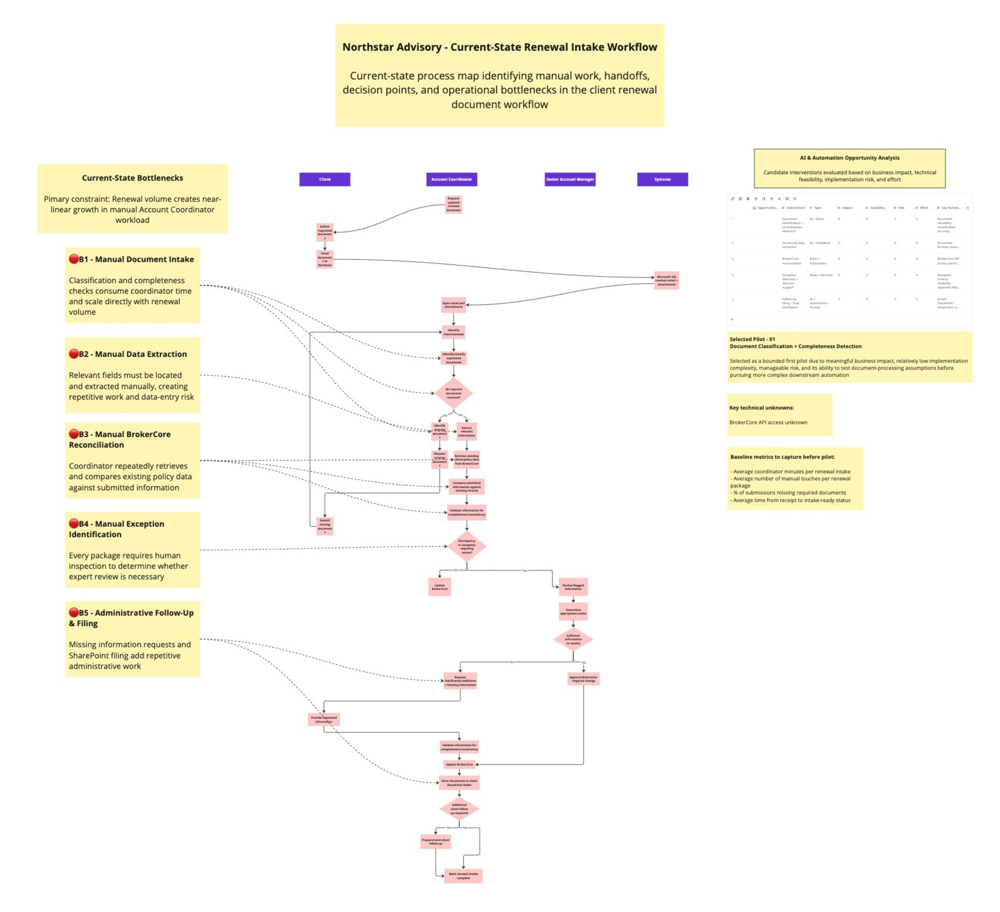
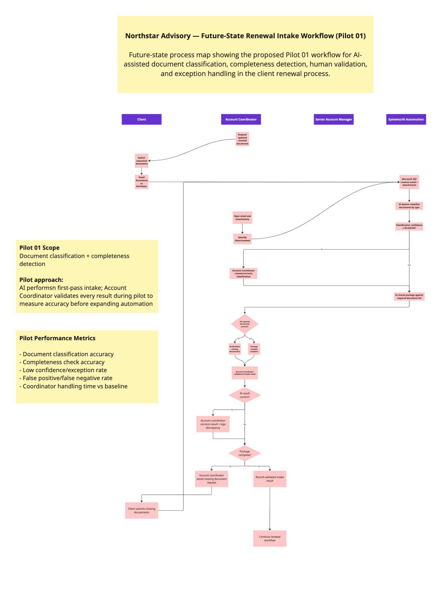
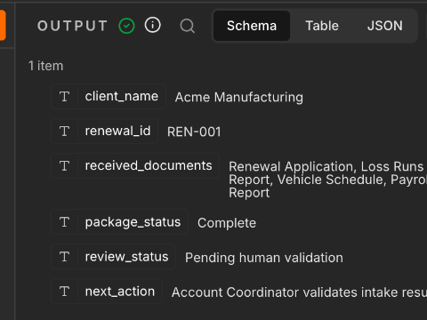
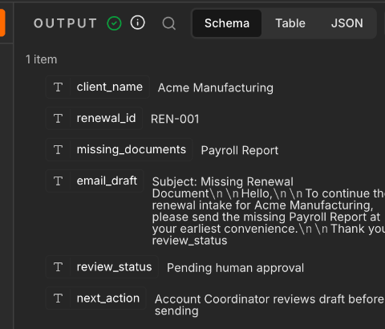
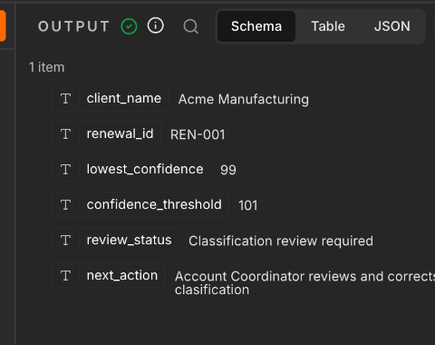

# Northstar Advisory — AI-Assisted Renewal Intake Pilot

> **Portfolio case study:** Northstar Advisory Group is a simulated company created to demonstrate AI operations, workflow design, and implementation thinking. The business context, stakeholders, and baseline figures in this repository are simulated for the case study.

## Overview

Northstar Advisory's renewal intake process relies heavily on manual document review. As renewal volume increases, Account Coordinators spend more time opening submissions, identifying document types, checking whether required documents are present, and following up on incomplete packages.

For this case study, I mapped the current workflow, identified the biggest sources of repetitive work, and designed a focused AI pilot to reduce manual intake effort without trying to automate the entire process at once.

## The Problem

I identified five main opportunities for improvement:

- Manual document intake
- Manual data extraction
- BrokerCore reconciliation
- Exception identification
- Administrative follow-up

Rather than trying to automate all five areas immediately, I selected **document classification and completeness detection** as Pilot 01.

The goal was to start with a contained use case where AI could handle repetitive first-pass work while keeping a human involved in validation.

## Current-State Workflow

The current-state map shows the existing renewal intake process, including manual handoffs, decision points, and the five main operational bottlenecks identified during the analysis.

## Pilot 01

When renewal documents arrive, the AI system:

**Classifies each document → checks classification confidence → compares the package against the required-document checklist → identifies whether the submission is complete or missing documents.**

Low-confidence classifications are sent to the Account Coordinator for review.

During the pilot, the Account Coordinator also validates every AI-generated intake result. Any incorrect classifications or completeness decisions are corrected and logged.

This allows the team to measure the system's accuracy before deciding whether high-confidence cases should eventually move forward without manual review.

## Future-State Workflow

The proposed future-state workflow introduces AI-assisted document classification and completeness detection while keeping the Account Coordinator in the loop for validation and exception handling during the pilot.

## n8n Prototype

The prototype implements the Pilot 01 logic in n8n, including AI-assisted document classification, confidence-based routing, completeness checks, and human-review paths.

## Prototype Result and Limits

**Result so far:** The n8n prototype implements the proposed pilot flow using a manually entered sample renewal package. It classifies four document descriptions, checks the reported classification confidence against a 90-point threshold, compares classifications with the required-document list, and routes complete, incomplete, and low-confidence outcomes to distinct review paths. For an incomplete package, it generates a draft request for the missing documents. The observed manual tests and screenshots below document each branch with sample inputs.

**Limits:** Northstar Advisory is fictional, and the inputs are sample text descriptions rather than uploaded PDFs. The workflow does not connect to a live inbox, document store, BrokerCore, or an operational approval queue; its final nodes mark items for human review in the workflow output. The model's confidence score is self-reported and has not been calibrated against labeled examples. No classification accuracy, completeness accuracy, handling-time reduction, or return on investment has been measured. Any time savings remain a hypothesis until the pilot paths are run and compared with a manual baseline.

**Observed manual tests (October 10, 2026):**

- **Complete package:** The run reached `Queue Complete Package for Validation`. Output listed all four required document categories, `package_status: Complete`, and `review_status: Pending human validation`.
- **Missing Payroll Report:** The run reached `Queue for Human Review`. Output identified `Payroll Report` in `missing_documents` and drafted a request for it. An initial run appended the literal text `review_status` to the email draft. After correcting the live field, a repeat run showed `Payroll Report` as missing and an email draft without that stray text.
- **Forced low-confidence routing:** With the threshold temporarily raised to 101, the run reached `Queue Classification Review` and displayed lowest confidence 99 and threshold 101. This confirms the branch routing under a forced threshold; it does not establish calibration or natural low-confidence detection. The live threshold was subsequently restored to 90.

**Test screenshots (cropped to the n8n output):**

Complete package:

Missing Payroll Report, corrected repeat run:

Forced low-confidence routing:

**Verification status:** The live threshold was restored to 90 and the sample Payroll Report value was restored after testing. These screenshots demonstrate branch routing and selected output fields, but do not establish measured accuracy or time savings. The repository workflow export has a clean email expression.

## Measuring Success

Before the pilot, baseline measurements would include:

- Coordinator handling time per renewal
- Human touches per renewal
- Incomplete submissions
- Total intake cycle time

Pilot performance would be measured using:

- Document classification accuracy
- Completeness-check accuracy
- Low-confidence / exception rate
- False positive / false negative rate
- Coordinator handling time vs. baseline

The goal is not simply to prove that AI can perform the task. It is to determine **where AI is reliable enough to reduce manual work and where human judgment should remain part of the process.**

## Next Steps

If Pilot 01 performs well, high-confidence routine submissions could gradually move toward straight-through processing while uncertain or unusual cases continue to receive human review.

Additional opportunities could then be evaluated, including automated data extraction, BrokerCore reconciliation, exception detection, and administrative follow-up.

## Project Artifacts

- [Business Brief](./01-business-brief.md)
- [Stakeholder Discovery](./02-stakeholder-discovery.md)
- [Current-State Workflow](./assets/current-state-workflow.jpg)
- [Future-State Workflow](./assets/future-state-workflow.jpg)
- [n8n Prototype Workflow](./n8n/renewal-intake-workflow.json) — working prototype covering classification, confidence routing, completeness checks, and human-review paths
- Loom Demo — coming next
